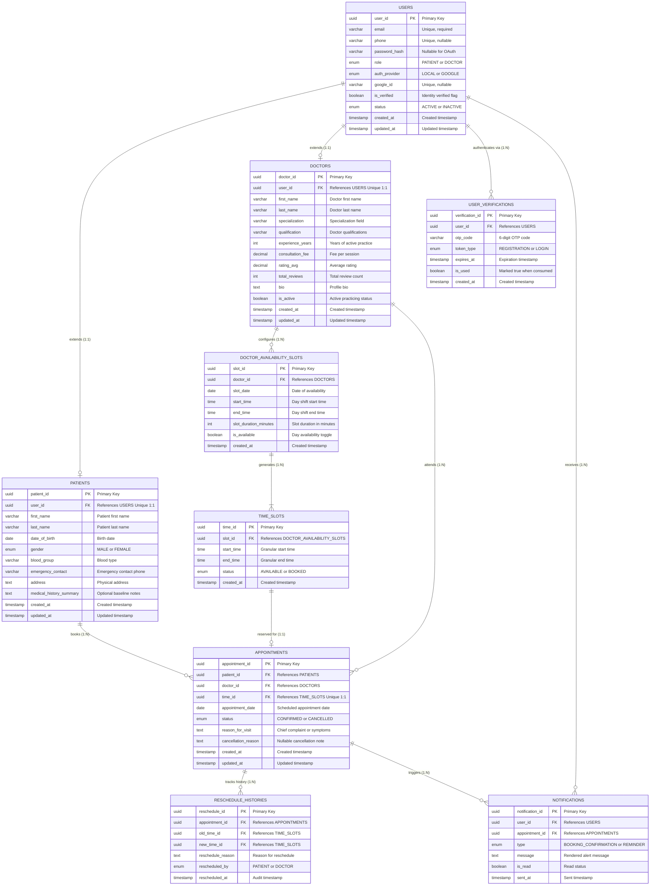

# ER Diagram Specification: Schedule Project Module
**PearlThoughts Internship Programme**  
**Document:** Database Entity-Relationship (ER) Design  
**Author:** Engineering Intern  
**Target Codebase / Framework:** NestJS / PostgreSQL / TypeORM  
**Reference Document:** [Weekly Plans – Patient & Doctor Experience](https://github.com/PearlThoughtsInternship/Internship-Obsidian-Vault/blob/main/Programme-Structure/Weekly-Plans.md)

---

## 1. Executive Summary
This document provides the Entity-Relationship (ER) design for the **Schedule Project Module** for PearlThoughts. The database architecture is designed in 3rd Normal Form (3NF) to support authentication, role-based onboarding (Patient vs Doctor), doctor discovery, slot availability generation, appointment booking, rescheduling history tracking, and automated notification triggers.

The design is organized strictly into five sequential modules:
1. **User Module** (Authentication, Google OAuth, Roles & Verification)
2. **Patient Module** (Patient Profiles & Demographics)
3. **Doctor Module** (Doctor Profiles, Specialties, Qualifications & Ratings)
4. **Availability Module** (`Doctor ↔ Slot 1:N`, `Slot ↔ Time 1:N`)
5. **Appointment Module** (`Appointment ↔ Patient N:1`, `Appointment ↔ Doctor N:1`, `Appointment ↔ RescheduleHistory 1:N`, Notifications)

---

## 2. Visual Mermaid ER Diagram

---

## 3. Detailed Module Breakdown

### Module 1: User Module
*Requirements Covered: Week 1 – Registration, Social Login (Google OAuth), OTP/Email Verification, Role Choice.*

1. **`USERS`**:
   - Acts as the central identity table for both patients and doctors.
   - `role`: Enforces role-based access control (`PATIENT`, `DOCTOR`, `ADMIN`).
   - `auth_provider`: Supports traditional local registration and social login via Google OAuth (`LOCAL`, `GOOGLE`).
   - `is_verified`: Guarantees that only verified email/phone numbers can access protected features.
2. **`USER_VERIFICATIONS`**:
   - Manages one-time passwords (OTP) and verification tokens with TTL (`expires_at`) to secure user onboarding.

### Module 2: Patient Module
*Requirements Covered: Week 1 & 2 – Patient onboarding walkthrough and booking.*

1. **`PATIENTS`**:
   - Has a **1:1 relationship with `USERS`** (`user_id` is unique foreign key).
   - Stores essential healthcare demographics: date of birth, gender, blood group, emergency contact phone, and address.
   - Separating profile data from the authentication table ensures security compliance (HIPAA/GDPR) and clean separation of concerns.

### Module 3: Doctor Module
*Requirements Covered: Week 1 & 2 – Doctor onboarding, specialty listing, ratings, and doctor discovery.*

1. **`DOCTORS`**:
   - Has a **1:1 relationship with `USERS`** (`user_id` is unique foreign key).
   - Holds doctor-specific metadata: `specialization` (e.g., Cardiology, Dermatology), `qualification` (MBBS, MD), `experience_years`, `consultation_fee`, and `rating_avg` / `total_reviews`.
   - Directly enables the patient search feature: *"Locate doctor by specialty / ratings / availability"*.

### Module 4: Availability Module
*Requirements Covered: Week 2 – Availability schedules and bookable time slots.*
*Exact Document Relationship: `Doctor ↔ Slot (1:N)`, `Slot ↔ Time (1:N)`.*

1. **`DOCTOR_AVAILABILITY_SLOTS` (The Slot Entity)**:
   - Represents a doctor's scheduled shift block on a specific date (e.g., Dr. Smith on Oct 28th, from 09:00 to 17:00, with 30-minute intervals).
   - Each doctor can define multiple availability dates (`Doctor ↔ Slot` is `1:N`).
2. **`TIME_SLOTS` (The Time Entity)**:
   - The child entity generated from the parent slot block (`Slot ↔ Time` is `1:N`).
   - Contains the exact granular start and end times (e.g., 09:00–09:30, 09:30–10:00).
   - Maintains real-time availability states: `AVAILABLE`, `RESERVED`, `BOOKED`, `BLOCKED`.
   - Prevents double-booking at the database constraint level.

### Module 5: Appointment Module
*Requirements Covered: Week 2 (Booking & Cancellation) & Week 3 (Reschedule Experience & History).*

1. **`APPOINTMENTS`**:
   - Represents the confirmed or pending appointment between a `Patient` and a `Doctor`.
   - Relationships:
     - `PATIENTS ↔ APPOINTMENTS` (`1:N` / `N:1` reverse): One patient can have multiple appointments.
     - `DOCTORS ↔ APPOINTMENTS` (`1:N` / `N:1` reverse): One doctor can conduct multiple appointments.
     - `TIME_SLOTS ↔ APPOINTMENTS` (`1:1`): Each appointment is pinned to exactly one unique time slot.
   - Status transitions: `CONFIRMED` → `COMPLETED` or `CANCELLED` or `RESCHEDULED`.
2. **`RESCHEDULE_HISTORIES`**:
   - Matches Week 3 technical requirement: `Appointment ↔ RescheduleHistory (1:N)`.
   - Preserves audit trails whenever a patient reschedules an existing appointment, recording `old_time_id`, `new_time_id`, `reschedule_reason`, and `rescheduled_at`.
3. **`NOTIFICATIONS`**:
   - Supports the required notification flow:
     > *"Your appointment with Dr. XYZ on DD/MM/YYYY at HH:MM is confirmed."*
   - Also delivers reminders, reschedule alerts, and cancellation notices.

---

## 4. Entity Relationships & Cardinalities Summary

| Source Entity | Target Entity | Cardinality | Business Rule / Description |
|---|---|---|---|
| `USERS` | `PATIENTS` | **1 : 1** (Optional to One) | A user with role `PATIENT` has exactly one patient profile. |
| `USERS` | `DOCTORS` | **1 : 1** (Optional to One) | A user with role `DOCTOR` has exactly one doctor profile. |
| `USERS` | `USER_VERIFICATIONS` | **1 : N** | A user can request multiple OTP verification codes over time. |
| `DOCTORS` | `DOCTOR_AVAILABILITY_SLOTS` | **1 : N** | A doctor configures availability for multiple days/shifts. |
| `DOCTOR_AVAILABILITY_SLOTS` | `TIME_SLOTS` | **1 : N** | An availability block breaks down into multiple granular time slots. |
| `PATIENTS` | `APPOINTMENTS` | **1 : N** | A patient can book multiple appointments over time. |
| `DOCTORS` | `APPOINTMENTS` | **1 : N** | A doctor attends multiple patient appointments. |
| `TIME_SLOTS` | `APPOINTMENTS` | **1 : 1** | A booked appointment occupies exactly one time slot (unique constraint). |
| `APPOINTMENTS` | `RESCHEDULE_HISTORIES` | **1 : N** | An appointment can be rescheduled multiple times with full history. |
| `USERS` / `APPOINTMENTS` | `NOTIFICATIONS` | **1 : N** | Automated triggers dispatch booking, reminder, and reschedule notifications. |

---

## 5. Key Architectural Strengths
- **No Concurrency Glitches:** Unique index on `APPOINTMENTS(time_id)` guarantees zero double bookings even under heavy concurrent load.
- **Audit & Compliance:** Dedicated `RESCHEDULE_HISTORIES` table guarantees complete traceability for healthcare compliance.
- **Clean Extensibility:** Clean decoupling of authentication (`USERS`) from healthcare domains (`PATIENTS`, `DOCTORS`) allows future roles (e.g., Clinic Staff, Lab Techs) without altering core scheduling logic.
